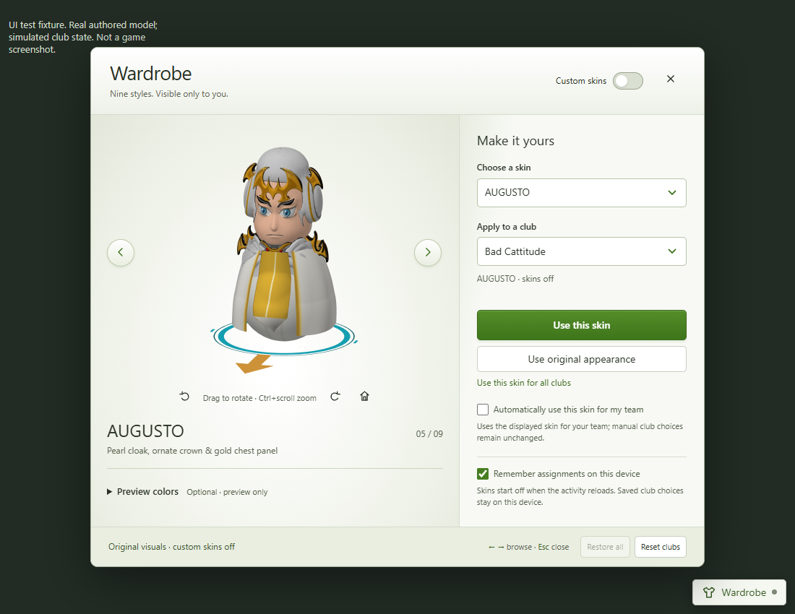

# Bobble Addons · Wardrobe

An **open-source, unofficial Windows launcher** for local Bobble League cosmetics.
Wardrobe is the only implemented add-on. This repository is separate from Bobble Recorder.

## Download

**[Download Preview 5](https://github.com/Hydrogeners/bobble-wardrobe/releases/tag/v0.1.0-preview.5)** · [Build it yourself](docs/BUILD.md) · [Security and privacy](SECURITY.md)

> **Development preview, not a finished product.** Native in-match attachment,
> Discord pop-out behavior and fresh-machine installation still need validation.
> The Windows executable is not code-signed and may trigger SmartScreen. Public
> source and passing tests are not a guarantee of safety or Discord compatibility.

### Install or upgrade

1. Fully quit Discord Stable from its system tray menu.
2. Open `BobbleWardrobe-Preview.exe`, select your installation, and choose **Install Wardrobe**.
3. Reopen Discord and launch Bobble League. Use the Wardrobe button to select a skin.

**Already installed?** Preview 4's helper receives this skin/in-game UI update
automatically from the quality feed, after a full Discord exit. Download Preview 5
once for the new desktop UI and signed launcher auto-updates. Choose **Update /
repair Wardrobe** with Discord closed to upgrade the resident helper too.

**Preview 1–3 users:** download Preview 5 once and choose **Install Wardrobe**
with Discord fully closed to migrate to the quality feed. Their smaller legacy
feed stays unchanged; old executables cannot learn binary auto-updating remotely.

To remove it, fully quit Discord, open the launcher and choose **Uninstall**.
Uninstall disables maintenance and removes the owned startup helper. Unknown
conflicts are retained rather than overwritten. See [how it works](docs/ARCHITECTURE.md).

## Skins

- **Hydro, MIKO, TODO, JJCHO, AUGUSTO, FLAIR, SUPA, DUOLINGO and Spark:** textured
  quality models with reference-specific rolling bases, repaired surface
  orientation and corrected head/body/ball dimensions.

Preview 5 bundles payload **13**: a straighter pearl cloak, gold chest panel and
pointed white center for AUGUSTO; targeted outfit cleanup across all nine; refined
rolling-base colors and patterns. Facial geometry and source winding are retained.
The retired tenth skin is no longer bundled or selectable; its old assignments
fall back to Original with a notice. Other saved assignments remain intact. See
[quality-model notes and remaining limitations](docs/QUALITY-MODELS.md).

Only the head/body/base meshes and cloned cosmetic materials are replaced.
There are no intended changes to physics, colliders, controls, animation or networking.
Assignments are local; custom cosmetics start disabled after reload.

## Signed updates

**Skins + in-game UI:** the launcher checks when opened, and the installed helper
checks hourly. Only Ed25519-signed payloads from the pinned HTTPS feed are accepted.
Updates to the three owned JavaScript files are cached while Discord runs and
applied after a full exit. Discord is never killed or restarted.

**Desktop launcher (Preview 5+):** on opening, a separate signed descriptor can
download a newer executable to a per-user cache, verify its exact size/hash and
signature, then open it automatically. The original portable file remains a
bootstrap; no running executable is overwritten. Failed/offline checks leave the
current launcher usable. Cached launchers are reverified before handoff.

The resident helper is **not** silently replaced: use **Update / repair Wardrobe**
with Discord closed when upgrading it. Binary signing here is our Ed25519 update
verification, **not** Windows Authenticode; SmartScreen may still appear.

- [Quality-model feed (Preview 4+)](wardrobe-quality-update.json)
- [Signed launcher descriptor (Preview 5+)](launcher-update.json)
- [Legacy feed (Preview 3; unchanged)](wardrobe-update.json)
- [Pinned public key and URL](launcher/update-policy.json)
- [Verification code](launcher/signed_updates.py)
- [Release verification](docs/VERIFY.md)

## Read the code

- [`launcher/`](launcher/): desktop app, journaled installer, background helper,
  Electron bridge, update verification, signing/publishing tools and tests.
- [`hydro/integration/`](hydro/integration/): guarded Unity cosmetic controller,
  skin manager, showroom, preview renderer, asset preparation and tests.
- [`launcher/launcher_updates.py`](launcher/launcher_updates.py): signed binary verification and handoff.
- [`launcher/bundle/`](launcher/bundle/): exact JS payloads supplied by Preview 5.
- [`docs/RELEASE-PREVIEW-5.json`](docs/RELEASE-PREVIEW-5.json): current executable/payload hashes.
- [`docs/RELEASE-PREVIEW-4.json`](docs/RELEASE-PREVIEW-4.json): executable/payload hashes.
- [`docs/RELEASE-PREVIEW-3.json`](docs/RELEASE-PREVIEW-3.json): preserved earlier record.

The distributed app's source is included. Private signing keys, Discord profiles,
extracted game files, local debugging captures and unrelated recorder/assistant
overlays are **not** part of this repository or release.

## Limitations

- Guarded for game build `Prod-590-CL28650`; unknown builds/signatures are refused.
- Snow Ballers and native halo/arrow recoloring are unsupported; optional color controls are preview-only.
- Discord updates that immediately relaunch may postpone repair until a later full exit.
- No clean-machine or complete native gameplay validation claim.
- This modifies a third-party client. Review Discord's applicable terms; this is
  not affiliated with or endorsed by Discord, Pokémon or Bungo Stray Dogs.

## Contributing and licensing

See [CONTRIBUTING.md](CONTRIBUTING.md), [LICENSE](LICENSE) and
[asset/third-party notices](THIRD_PARTY_NOTICES.md). Suggestions and reproducible
bug reports are welcome. Please never post account tokens, profiles or private keys.
